<div align="center">


</div>


## What It Is

Spongebob is an open-source, terminal-based **Network Impairment Simulator** focused on **Delay**, **Jitter**, and **Packet Loss**. You configure a multi-hop network path, inject controlled impairments into a simulated packet flow on a deterministic virtual clock, measure the resulting network metrics, and inspect rule-based findings and live terminal animations.

- **Delay:** Each packet waits a set time at a hop before moving on.
- **Jitter:** Wait times vary randomly per packet (uniform or normal), which can cause packets to arrive out of order.
- **Packet Loss:** Packets are dropped at a hop via random percentage, Gilbert-Elliott bursty loss, or queue-full tail drops under a bandwidth cap.


## Install and Run

Requires **Python 3.11+**.

From a local clone:

```bash
pipx install .
```

For development (editable install):

```bash
pipx install -e .
```

Launch the terminal UI (opens the main menu):

```bash
spongebob
```

CLI flags and headless module runners:

```bash
spongebob --version
spongebob --help
spongebob scenarios
spongebob run <file.toml | builtin-name> [--seed N] [--export <path>]
spongebob diagnose <host> [--port 443] [--count 20] [--interval-ms 200] [--dns] [--export <path> | --export-downloads [md|json|csv]]
spongebob plugins <dir>
python -m spongebob
python -m spongebob.engine
python -m spongebob.meter
python -m spongebob.analyzer
```

Run the test suite:

```bash
pytest -v
```


## Screens

- **Menu:** Keyboard-first launcher for **Simulate**, **Visualize**, **Diagnose**, **Settings: Narrator ON/OFF** (session-only), and **Quit**.
- **Simulate:** Edit flow settings (packet count, interval, size, seed) and per-hop impairments (`client`, `router`, `isp`, `server`) with live validation. Displays measured metrics, severity-colored findings pinned to the responsible hop, and mascot narration. Press `V` from results to open **Visualize** with that run.
- **Diagnose:** Configure a single target host, port, probe count, interval, and optional DNS check, confirm consent, and inspect live RTT metrics, segment-pinned findings, mascot narration, and non-loss errors. Press `V` from results to open **Visualize** in RTT mode.
- **Visualize:** Full-terminal Braille living-pipe animation replaying events through the synchronous event bus, with bandwidth bottlenecks, queue pileups, distinct drop effects (including silent fade-out for probe timeouts), live telemetry, and a diagnostic scan pulse that stalls at the highest-severity hop. Controls: `Space` pause/resume, `+`/`-` speed (`0.25x`–`8x`), `R` restart, `P` pulse, `Esc` back.


## Diagnose Mode

Diagnose mode probes a single user-supplied target using bounded TCP connect timing (and optional system DNS resolution) and feeds the resulting samples into the same meter, analyzer, narrator, and visualizer pipeline.

- **How to run:** Choose **Diagnose** from the main menu, or run `spongebob diagnose <host> [--port 443] [--count 20] [--interval-ms 200] [--dns]`.
- **What it contacts:** Only the target host and single port you type in, and only after you explicitly confirm the consent prompt (`y`).
- **Honest limits:**
  - Measures **round-trip time (RTT)**, not one-way delay.
  - TCP connect timeouts **approximate packet loss**; they are not exact packet loss.
  - `BANDWIDTH_CHOKE` and `REORDERING` findings are skipped (not observable from connect probes).
  - Throughput is reported as `n/a` (no application data is sent).
  - Safety limits enforced: single target, single port (`1-65535`), count capped at `200`, minimum interval `100 ms`, timeout `100-5000 ms`, and early abort after `3` consecutive non-loss errors (`refused`, `unreachable`, `dns_error`).
  - Nothing is saved to disk, no history is kept, and every run requires explicit confirmation.


## Reading the Metrics

- **Delay:** The fixed time a hop holds each packet before forwarding it, in milliseconds (`ms`).
- **Jitter:** How much packet-to-packet arrival timing wobbles (reported using the RFC 3550 smoothed jitter estimator and mean absolute delta in `ms`).
- **Packet Loss:** The percentage of sent packets that never reached the destination (`lost / sent * 100`), plus a per-hop breakdown showing which hop dropped them.
- **Latency (`min`, `avg`, `max`, `p95`):** Total one-way travel time from send to delivery in `ms`. `p95` means 95% of delivered packets arrived in that time or less.
- **Throughput (`kbps`):** Effective delivery rate in kilobits per second across the flow duration (`delivered bytes * 8 / duration_ms`).


## Privacy

- **No telemetry:** Zero usage metrics, crash reports, or analytics are collected or transmitted.
- **No update checks:** The software never phones home to check for new versions.
- **No network calls in simulation mode:** All flows, impairments, measurements, and analyses run purely in-memory on a virtual clock.
- **Nothing written to disk by default:** Configurations, events, metrics, findings, and narrator state stay in memory for the current session only.
- **Minimal dependencies:** Core modules use the Python standard library only; the UI uses one pinned third-party dependency (`textual==8.2.8`).

Spongebob aims for maximum practical privacy rather than making an "absolute" privacy claim. See [PRIVACY.md](PRIVACY.md) for details.


## Scenarios

Scenarios define a reproducible flow and hop path in TOML (`<= 64 KB`, `<= 12` hops, `<= 100,000` packets):

- **`[scenario]`:** `name`, `description`
- **`[flow]`:** `packets`, `interval_ms`, `size_bytes`, optional `seed`
- **`[[hop]]`:** `name`, `delay_ms`, `jitter_ms`, `loss_pct`, plus optional `jitter_model`, `bandwidth_kbps`, `queue_limit_packets`, `loss_model`, `p_good_to_bad`, `p_bad_to_good`, `loss_good`, `loss_bad`

Built-in scenarios:

- `control-line` — Clean wired baseline (no findings)
- `crowded-wifi` — Peak-hour wireless jitter and mild loss
- `tunnel-burst` — Gilbert-Elliott two-state bursty loss
- `long-haul-orbit` — High propagation delay with steady timing
- `overloaded-uplink` — Tight bandwidth cap and queue-full tail drops
- `flaky-last-mile` — Degraded access link with random packet loss

Run from the CLI (`spongebob scenarios` to list, `spongebob run <file.toml | builtin-name> [--seed N]`) or load inside **Simulate**.


## Export

Both `spongebob run` and `spongebob diagnose` (and their UI result panels) support exporting reports only when you explicitly pass `--export <path>` or click **Export**:

- **`.json`:** Schema v1 with `spongebob_version`, `source`, `scenario` (when available), `metrics`, `findings`, `narrator`, and raw `events` only when `--events` is passed. Diagnose exports include `"latency_kind": "rtt"` and the typed target host/port.
- **`.csv`:** One row per packet (`seq`, `send_time_ms`, `outcome`, `latency_ms`, `drop_hop`, `drop_reason`) with formula-injection escaping.
- **`.md`:** Human-readable report with configured vs. measured values (for simulations), full metrics, severity-ordered findings, mascot lines (omit with `--no-narrator`), and honest RTT/timeout limits (for diagnose).

Exports are deterministic (no timestamps), atomic, never create missing parent folders, and refuse to overwrite existing files unless `--force` (or UI confirmation) is given. In Diagnose mode, the UI Export dialog suggests a file in your Downloads folder (`spongebob-diagnose-<target>.md`), shows the exact path first, and writes only after you press Save (or pass `--export-downloads` on the CLI). Diagnose reports include the target host you typed, so share them with care.


## Plugins

Plugins are **data-only** folders containing `plugin.toml` plus TOML data files (`<= 20` files, `<= 64 KB` each, `<= 512 KB` total). Spongebob **never** imports, `eval`s, or executes code from plugins. Loading is **explicit only** (`--plugins <dir>` on the CLI or **Plugins & Settings** in the UI).

Three plugin kinds are supported:

1. **`scenarios`** — `.toml` scenario files registered as `<plugin-name>/<scenario>` (cannot override built-ins):

```toml
# plugin.toml
name = "campus-lab"
version = "0.1.0"
kind = "scenarios"
description = "Lab impairment scenarios"
```

2. **`jokes`** — Additional lines for `[findings]` (`"CODE.severity"`) and `[drop_reasons]` (`<= 200` chars, `{hop}` and `{value}` only, no control/ANSI escapes or banned names), added to built-in pools:

```toml
# jokes.toml
[findings]
"HIGH_DELAY.warn" = ["{hop} is paddling slowly at {value} ms!"]
```

3. **`theme`** — 6-digit hex color overrides under `[colors]` validated for contrast ratio `>= 4.5`:

```toml
# theme.toml
[colors]
bg = "#000501"
cream = "#cbf7bc"
```


## Roadmap

- **Candidate:** Time-varying scenarios (impairments that change mid-run).




