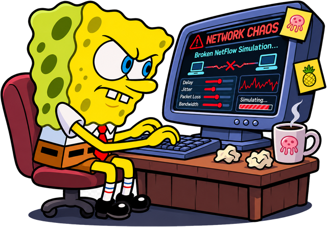

<div align="center">




</div>


## What It Is

Spongebob is an open-source, terminal-based **Network Impairment Simulator** focused on **Delay**, **Jitter**, and **Packet Loss**. You configure a multi-hop network path, inject controlled impairments into a simulated packet flow on a deterministic virtual clock, measure the resulting network metrics, and inspect rule-based findings and live terminal animations.

- **Delay:** Each packet waits a set time at a hop before moving on.
- **Jitter:** Wait times vary randomly per packet (uniform or normal), which can cause packets to arrive out of order.
- **Packet Loss:** Packets are dropped at a hop via random percentage, Gilbert-Elliott bursty loss, or queue-full tail drops under a bandwidth cap.


## Install and Run

Requires **Python 3.11+**.

From a local clone:

```bash
pipx install .
```

For development (editable install):

```bash
pipx install -e .
```

Launch the terminal UI (opens the main menu):

```bash
spongebob
```

CLI flags and headless module runners:

```bash
spongebob --version
spongebob --help
python -m spongebob
python -m spongebob.engine
python -m spongebob.meter
python -m spongebob.analyzer
```

Run the test suite:

```bash
pytest -v
```


## Screens

- **Menu:** Keyboard-first launcher for **Simulate**, **Visualize**, **Diagnose (`v0.2`, disabled)**, **Settings: Narrator ON/OFF** (session-only), and **Quit**.
- **Simulate:** Edit flow settings (packet count, interval, size, seed) and per-hop impairments (`client`, `router`, `isp`, `server`) with live validation. Displays measured metrics, severity-colored findings pinned to the responsible hop, and mascot narration. Press `V` from results to open **Visualize** with that run.
- **Visualize:** Full-terminal Braille living-pipe animation replaying events through the synchronous event bus, with bandwidth bottlenecks, queue pileups, distinct drop shatter effects, live telemetry, and a diagnostic scan pulse that stalls at the highest-severity hop. Controls: `Space` pause/resume, `+`/`-` speed (`0.25x`–`8x`), `R` restart, `P` pulse, `Esc` back.


## Reading the Metrics

- **Delay:** The fixed time a hop holds each packet before forwarding it, in milliseconds (`ms`).
- **Jitter:** How much packet-to-packet arrival timing wobbles (reported using the RFC 3550 smoothed jitter estimator and mean absolute delta in `ms`).
- **Packet Loss:** The percentage of sent packets that never reached the destination (`lost / sent * 100`), plus a per-hop breakdown showing which hop dropped them.
- **Latency (`min`, `avg`, `max`, `p95`):** Total one-way travel time from send to delivery in `ms`. `p95` means 95% of delivered packets arrived in that time or less.
- **Throughput (`kbps`):** Effective delivery rate in kilobits per second across the flow duration (`delivered bytes * 8 / duration_ms`).


## Privacy

- **No telemetry:** Zero usage metrics, crash reports, or analytics are collected or transmitted.
- **No update checks:** The software never phones home to check for new versions.
- **No network calls in simulation mode:** All flows, impairments, measurements, and analyses run purely in-memory on a virtual clock.
- **Nothing written to disk by default:** Configurations, events, metrics, findings, and narrator state stay in memory for the current session only.
- **Minimal dependencies:** Core modules use the Python standard library only; the UI uses one pinned third-party dependency (`textual==8.2.8`).

Spongebob aims for maximum practical privacy rather than making an "absolute" privacy claim. See [PRIVACY.md](PRIVACY.md) for details.


## Roadmap

- **v0.1 (current):** Discrete-event engine, meter, synchronous event bus, rule-based analyzer, Textual UI + Braille visualizer, and rule-based mascot narrator.
- **v0.2:** Diagnose mode (probing user-supplied targets).
- **v0.3:** Scenario files, export, and plugins.


